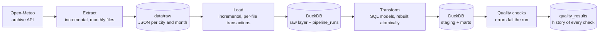

# Weather Warehouse: an incremental data pipeline

[](https://github.com/YOUR_USERNAME/weather-warehouse/actions/workflows/ci.yml)


A small data engineering project: it pulls hourly historical weather for several cities from the Open-Meteo archive API, lands the raw responses as files, and (as the project grows) models them into clean analytics tables with automated quality checks, on a daily schedule.

## Status

| Step | State |
|---|---|
| Extract: land raw JSON, incrementally and idempotently | Done |
| Load raw files into a DuckDB raw layer, with a run log | Done |
| Staging layer: typed, de-duplicated, explicit units | Done |
| Marts layer: daily and monthly city summaries | Done |
| Data quality checks that fail the run | Done |
| Run log table | Done |
| One command that runs every step, with a failure policy | Done |
| Daily schedule (GitHub Actions, state kept in the Actions cache) | Done |
| Cloud storage and warehouse | Planned (see roadmap) |

## Contents

- [Architecture](#architecture)
- [Data source](#data-source)
- [Getting started](#getting-started)
- [How the extract step works](#how-the-extract-step-works)
- [How the load step works](#how-the-load-step-works)
- [Data model and transformations](#data-model-and-transformations)
- [Data quality checks](#data-quality-checks)
- [Running everything and scheduling](#running-everything-and-scheduling)
- [Roadmap: moving to the cloud](#roadmap-moving-to-the-cloud)
- [Project structure](#project-structure)
- [Design decisions](#design-decisions)
- [Testing and CI](#testing-and-ci)

## Architecture



## Data source

Hourly weather (temperature, humidity, precipitation, wind speed, cloud cover) from the [Open-Meteo](https://open-meteo.com/) historical archive. No API key is needed. The free service is intended for non-commercial use and has usage limits, so check the current terms on their site, and keep the request volume low (this project pauses between requests and only fetches what is missing).

Weather data by Open-Meteo.com, licensed [CC BY 4.0](https://creativecommons.org/licenses/by/4.0/).

## Getting started

```bash
git clone https://github.com/YOUR_USERNAME/weather-warehouse.git
cd weather-warehouse
python -m venv .venv

# Windows
.venv\Scripts\activate
# macOS / Linux
source .venv/bin/activate

pip install -r requirements-dev.txt
pip install -e .
```

See what the first run would do, without any network calls:

```bash
python -m weatherwh.extract --dry-run
```

Run the whole pipeline in one command (extract, load, transform, quality checks):

```bash
python -m weatherwh.run
```

Or run the steps one at a time. Fetch the data (the first run loads every month back to the start date; later runs fetch only what is new):

```bash
python -m weatherwh.extract
python -m weatherwh.extract --start 2023-01-01 --cities paris,london   # a smaller run
```

Load the landed files into DuckDB (also incremental; unchanged files are skipped):

```bash
python -m weatherwh.load
```

Build the staging and marts layers from the raw layer (rebuilt completely each time):

```bash
python -m weatherwh.transform
```

Run the data quality checks (exits with a non-zero code if any error-level check fails):

```bash
python -m weatherwh.quality            # shows failures and warnings
python -m weatherwh.quality --verbose  # also lists the checks that passed
```

Look at the run history:

```python
import duckdb
con = duckdb.connect("data/warehouse/weather.duckdb", read_only=True)
query = "SELECT run_id, status, files_loaded, files_skipped, files_failed, rows_loaded FROM pipeline_runs ORDER BY started_at DESC"
for row in con.execute(query).fetchall():
    print(row)
```

Cities, variables and the start date live in `src/weatherwh/config.py`. Run the tests and lint:

```bash
python -m pytest
ruff check .
```

## How the extract step works

1. **Plan:** split the date range into calendar months, and for each city and month check whether the file in `data/raw/<city>/<YYYY-MM>.json` already covers the whole window. Only missing or incomplete files are fetched.
2. **Fetch:** call the API with retries and exponential backoff for temporary failures (timeouts, rate limiting, server errors). A bad request is reported with the API's own explanation and is not retried.
3. **Validate:** check that the response has the expected variables, equal-length columns, and exactly one row per hour from 00:00 of the first day to 23:00 of the last. Anything else is rejected and never saved.
4. **Land:** write the untouched response inside a small envelope that records the city, date window, fetch time, source URL and request parameters. The write is atomic (temp file, then rename), so a crash never leaves a half-written file.
5. **Report:** one failing city or month does not stop the rest; failures are listed at the end and the command exits with a non-zero code so a scheduler can notice.

Running it twice in a row does nothing the second time. Running it the next day refreshes only the current, still-growing month.

## How the load step works

1. **Create the tables if needed:** `raw_weather_hourly` (one row per city and hour), `raw_weather_files` (one row per loaded file) and `pipeline_runs` (one row per run). If an existing table no longer matches the configured variables, the load stops with a clear message instead of corrupting data.
2. **Skip what is unchanged:** each landed file is hashed (SHA-256). A file whose hash is already recorded is skipped, so changes are detected by content, not by modified time.
3. **Validate, then reshape:** the file is checked with the same rules as the extract step, then the API's column-wise arrays become one row per hour. Values are kept exactly as delivered (missing values stay `NULL`, timestamps stay text); every row carries its source file, fetch time, load time and run id.
4. **Replace atomically:** in one transaction, the file's old rows are deleted, its new rows inserted and its record updated. A failure part-way leaves the previous data untouched.
5. **Log the run:** `pipeline_runs` records start and finish time, files loaded, skipped and failed, rows loaded, and a status of `success`, `partial` or `failed`. A run that crashes mid-way is left as `running`, which makes it easy to spot.

One bad file is reported and does not stop the others; the command exits with a non-zero code if anything failed.

## Data model and transformations

The transformations are plain SQL files in `sql/`, run by `python -m weatherwh.transform`. Table prefixes show the layer.

| Layer | Table | Grain | Purpose |
|---|---|---|---|
| Raw | `raw_weather_hourly` | city, hour, per file | Values as delivered, with lineage |
| Staging | `stg_weather_hourly` | city, hour | De-duplicated, typed timestamp, date, month and hour columns, measurements renamed with units |
| Mart | `dim_city` | city | Name and coordinates, from the configuration |
| Mart | `fct_weather_daily` | city, day | Min, max and average temperature, total rain, wind, humidity, cloud cover, hours with data, complete-day flag |
| Mart | `fct_weather_monthly` | city, month | Temperature range and average, total rain, rainy days, based on complete days only |

Rules worth knowing:

- **De-duplication:** if the same city and hour appears in more than one file, the most recently fetched copy wins.
- **Missing values are skipped, never zero.** A day counts as complete only if all 24 hours are present, and monthly figures use complete days only, so gaps do not bias them. `days_total` and `days_complete` show how much each month rests on.
- **Atomic rebuild.** All four tables are rebuilt in one transaction. If any model fails, everything rolls back and the previous tables stay as they were.

Example queries:

```sql
-- Hottest days on record
SELECT c.city_name, d.observed_date, d.temp_max_c
FROM fct_weather_daily d JOIN dim_city c USING (city_slug)
WHERE d.is_complete_day = 1
ORDER BY d.temp_max_c DESC LIMIT 10;

-- Rainfall by month for one city
SELECT observed_month, precipitation_total_mm, rainy_days
FROM fct_weather_monthly WHERE city_slug = 'paris' ORDER BY observed_month;
```

## Data quality checks

After each build, `python -m weatherwh.quality` runs a set of named rules against the warehouse. Each rule counts its violations (zero means it passes) and, when it fails, shows a few example rows. Results are stored in `quality_results`, one row per check per run, so the history builds up, and the run itself is logged in `pipeline_runs`.

**Severity.** An *error* means the data cannot be trusted and fails the whole run (non-zero exit code, so a scheduler can stop or alert). A *warning* means something looks off but the data is usable; it is reported without failing the run. A check that cannot run at all (for example, a missing table) is recorded as an error and also fails the run, because a rule that silently does not run protects nothing.

| Area | What is checked | Severity |
|---|---|---|
| Structure | The raw layer has data. At most one row per city and hour. City, timestamp and date are never missing. Every city is a configured city. Hour of day is 0 to 23 | Error |
| Value ranges | Temperature, humidity, precipitation, wind speed and cloud cover stay within physically plausible limits (set in `config.py`) | Error |
| Completeness | No missing hours between a city's first and last hour. Every configured city has data up to the latest day the archive can provide | Error |
| Reconciliation | Staging has exactly one row per distinct city-hour in raw. The daily table has one row per city-day in staging. The monthly table has one row per city-month in the daily table | Error |
| Mart consistency | No day has more than 24 hours, a day's minimum is never above its maximum, a day is flagged complete exactly when it has 24 hours, a month's complete days never exceed its total days | Error |
| Earlier steps | The latest load and transform runs did not fail, and none is stuck in "running" beyond a few hours | Error |
| Soft signals | Few missing temperatures per city. No implausibly large day-and-night temperature swing. The latest runs had no failed files | Warning |

Look at the history of a check:

```sql
SELECT checked_at, status, violations, message
FROM quality_results WHERE check_name = 'freshness' ORDER BY checked_at DESC LIMIT 10;
```

## Running everything and scheduling

`python -m weatherwh.run` runs extract, load, transform and the quality checks in order and exits with a non-zero code if the data fails the quality gate. Its failure policy:

| Situation | What happens |
|---|---|
| A city or month cannot be fetched | The run continues with the data that did arrive. The quality checks then judge the result: a city that is only a day behind is a warning, a city that has gone stale fails the freshness check |
| The API is completely unreachable | Extract is recorded as failed, which fails the quality gate straight away |
| Load crashes outright | Transform is skipped, and the quality checks still run and report |
| Anything in the quality checks fails at error level | Non-zero exit code |

Every step is recorded in `pipeline_runs`, and on GitHub the run page shows a summary table of the steps and any quality problems.

**Daily schedule.** `.github/workflows/pipeline.yml` runs the pipeline every day at 05:17 UTC and can also be started by hand from the Actions tab. GitHub's runners start empty, so the `data/` folder is kept between runs in the GitHub Actions cache, saved even when the pipeline reports a problem. Things to know:

- The cache is limited to 10 GB per repository, and entries that are not read for 7 days are deleted. If that happens, the next run rebuilds everything from scratch (about 400 requests), because every step is incremental and idempotent.
- Scheduled workflows are best-effort: they can start late, and GitHub disables them in a public repository after 60 days with no repository activity. If the schedule stops, re-enable it in the Actions tab, or run it by hand.
- Cron times are in UTC, and the schedule only runs from the default branch.

## Roadmap: moving to the cloud

The pipeline already takes its database connection as a parameter and uses plain SQL, which keeps these steps small. Planned, in order:

1. **Managed warehouse.** Point the connection at a hosted DuckDB (MotherDuck) with a token stored as a repository secret, so the warehouse no longer depends on the Actions cache.
2. **Object storage for the raw files.** Put the landed JSON in an S3-compatible bucket behind a small storage interface (local folder or bucket), so the runner holds no state at all.
3. **Reliable triggering and monitoring.** An external trigger and a heartbeat monitor, so a missed or disabled schedule is noticed; alerts on failed runs.
4. **Containerize and consume.** A Docker image that can run on any cloud job service, and a dashboard or BI report reading the marts.

## Project structure

```
weather-warehouse/
├── .github/workflows/
│   ├── ci.yml                 # lint and tests on every push and pull request
│   └── pipeline.yml           # the daily scheduled pipeline run
├── data/
│   ├── raw/                   # landed JSON (contents gitignored)
│   └── warehouse/             # DuckDB database (gitignored)
├── src/weatherwh/
│   ├── config.py              # cities, variables, paths, HTTP settings
│   ├── extract.py             # plan, fetch, validate, land
│   ├── load.py                # raw layer: incremental, atomic per file, run log
│   ├── transform.py           # runs the SQL models atomically and logs the run
│   ├── quality.py             # named data quality checks, results history, pass/fail
│   └── run.py                 # runs every step in order, with a failure policy
├── sql/
│   ├── staging/stg_weather_hourly.sql
│   └── marts/                 # fct_weather_daily.sql, fct_weather_monthly.sql
├── tests/
│   ├── helpers.py             # fake API and a helper that lands files with it
│   ├── test_extract.py        # fake API responses; no network needed
│   ├── test_load.py           # runs on SQLite, plus one test on real DuckDB
│   ├── test_transform.py      # hand-built data with known answers, plus a real DuckDB test
│   ├── test_quality.py        # break one thing at a time and check the right rule catches it
│   └── test_run.py            # the whole pipeline: good days, bad days, crashes in each step
├── pyproject.toml
├── requirements.txt
└── requirements-dev.txt
```

## Design decisions

- **Monthly files.** One file per city and month keeps the number of API calls small, makes completed months permanent, and makes the incremental rule easy to state: a month is final once its file reaches the month's last day.
- **Raw data is never edited.** The API response is stored as received, with provenance alongside. Fixing, typing and de-duplicating happen in later layers, so any mistake there can be repaired by reprocessing.
- **Idempotent by design.** File names are deterministic and writes are atomic, so reruns and retries are always safe.
- **Fail loudly.** Responses are validated before they are saved, and failures surface in the exit code.
- **Standard library only for HTTP.** The extract step needs no third-party packages; the HTTP function takes its opener as a parameter so tests can run without a network.
- **UTC timestamps.** Requests ask for GMT, which avoids daylight-saving duplicates and gaps.
- **Raw means as delivered.** The raw tables keep values and timestamps untouched, with lineage columns added. Typing, de-duplication across overlapping files and unit handling belong to the staging layer.
- **Atomic, content-addressed loads.** Each file is replaced in a single transaction, and a content hash decides whether it needs loading, so reruns and retries are safe.
- **A run log from the start.** Every run is recorded with counts and a status, so failures and slow-downs are visible after the fact.
- **Models are SQL files, rebuilt from raw.** Each model states its grain and rules at the top. A full rebuild is simple, always consistent and fast at this size; incremental models would be the next step if volume grew.
- **A failure policy, not just a sequence.** A city that fails to download does not stop the others, and the quality gate (not the download step) decides whether what we have is acceptable. That keeps one flaky API response from turning the whole pipeline red, while genuine staleness still does.
- **Checks are named, severity-graded and recorded.** Errors fail the run; warnings inform. Every result is stored with a timestamp, so quality can be tracked over time, not just checked once.
- **A check that cannot run counts as a failure,** and one broken check never hides the others.
- **Portable SQL, injectable connection.** The load step uses plain SQL and takes the connection as a parameter, so its logic is tested quickly on SQLite while production uses DuckDB.

## Testing and CI

The extract tests replace the API with fake responses, covering month splitting, incremental planning (including month boundaries and widening the start date), retries and backoff, response validation, atomic writes, and partial failures. The load tests cover schema checks, first and repeated loads, refreshed files (no duplicates), corrupt and invalid files, a simulated crash that must leave earlier data intact, and the run log. The transform tests use small hand-built datasets with known answers (de-duplication, null handling, complete-day rules, monthly statistics), check that a failing model rolls everything back, and run the whole extract, load, transform chain end to end. The quality tests build one healthy warehouse, then corrupt exactly one thing per test (an impossible temperature, a duplicate hour, a missing day, stale data, a failed earlier run, a dropped table) and check that the right rule, and only the right rule, reacts. The orchestrator tests run the whole chain against a fake API through good days, one city failing, the API being down, data going stale, and a crash in each step. Most tests run on in-memory SQLite; one each for the load, transform, quality and run steps runs on a real DuckDB database and is skipped automatically if DuckDB is not installed. GitHub Actions runs `ruff check .` and `pytest` on every push to `main` and every pull request.